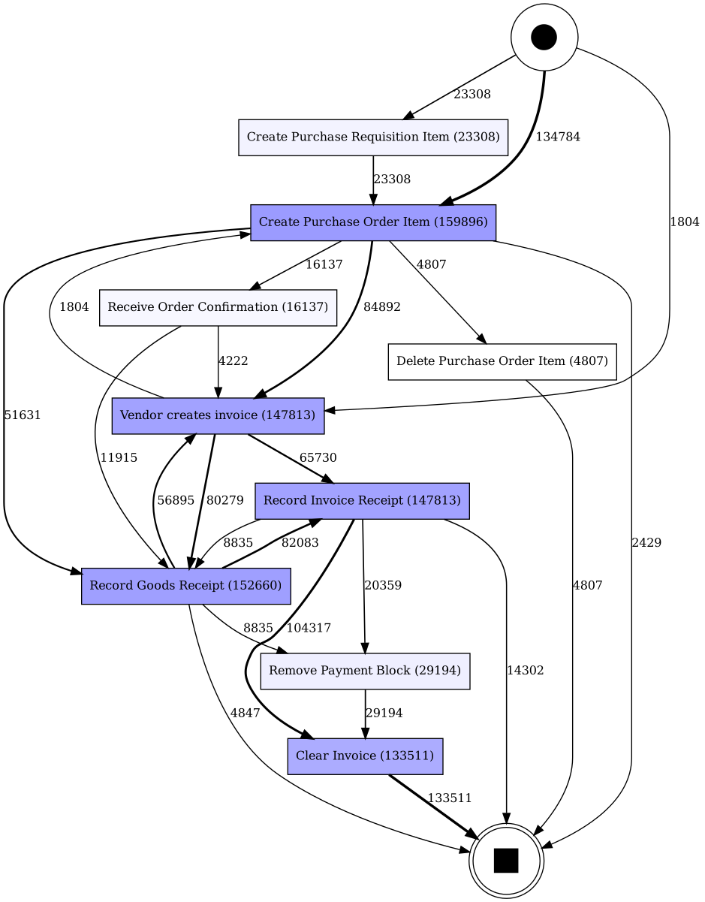

# Purchase-to-pay process mining on a real company's purchasing log

I took a real, public event log of a large company's purchasing process and asked seven questions a finance or procurement leader would care about. The aim was to find where the process breaks, put a size on it, and say what to look at first.

The short version: the process is fairly consistent for most items, but 16.9% of items in the main purchasing category show rework, payment blocks go with about 13 more days in median time to payment, and about 17% of main-category items leave a model learned from the most common paths.

It also flags 346 paid items, worth about EUR 1.97 million at order value, for a goods-receipt control review, and 390 more whose receipt history looks incomplete. Nothing here proves a loss; these are the items I would ask about first.

## The data

BPI Challenge 2019 (van Dongen, 2019), published on 4TU.ResearchData under CC BY 4.0, DOI 10.4121/uuid:d06aff4b-79f0-45e6-8ec8-e19730c248f1. It covers purchase orders from a multinational coatings and paints company, mostly from 2018, with names replaced by IDs.

One row is one event. A case is one purchase order item. The raw file has 1,595,923 events and 251,734 items.

Before counting anything I dropped duplicate event IDs (there were none) and removed 82 items that had an event dated outside 2017 to 2019 (some are dated 1948). That leaves 1,593,335 events and 251,652 items. Inside each item, events are ordered by time and then by event ID.

The CSV is 527 MB, so it is not in this repo. Download it from 4TU (the raw file should have 1,595,923 events and 251,734 items; `outputs/cleaning.json` records both), put `BPI_Challenge_2019.csv` in `data/`, and run:

```
pip install -r requirements.txt
python run.py data/BPI_Challenge_2019.csv
python -m pytest -q tests
```

Every number below comes from the files in `outputs/`. The 13 tests run on a small hand-built log, so they check the logic; the headline numbers need the full file. They also run on GitHub Actions on every push.

## What I found

**Q1. What kind of purchasing is this?**
87.8% of items (220,948 of 251,652) are "3-way match, invoice before goods receipt". 6.0% must be invoiced after goods arrive, 5.8% are consignment and 0.4% are 2-way match. In a 3-way match, the purchase order, goods receipt and invoice should all agree before anyone is paid.

**Q2. How many paths do items take?**
11,948 different paths. The single most common one (create order, vendor invoices, goods received, invoice recorded, invoice cleared) covers 20.0% of items, and the top 10 cover 59.5%. So most items follow a handful of paths, with a long tail of exceptions.

**Q3. How often is an item reworked?**
I counted an item as reworked if it had a price change, quantity change, delivery indicator change, deletion, or a cancelled goods receipt or invoice. 16.9% of the main category (37,261 of 220,948) and 19.6% of the invoice-after-goods category (2,974 of 15,162) were reworked. Quantity changes (21,443 events) and price changes (12,404) are the biggest sources.

It is not spread evenly. Among spend areas with at least 2,000 items, Trading & End Products is reworked at 32.5% (7,231 of 22,281), almost three times the rate in Sales (11.6%).

I left "Change Approval for Purchase Order" out of rework. In 2-way match items it shows up on nearly every item as a normal approval step, and counting it made those items look 100% reworked.

**Q4. Which paid items should a control reviewer look at?**
In a 3-way match, an invoice should only be cleared against a goods receipt that is still valid at that moment. So I judged every paid 3-way match item (183,292 of them) on what had happened by the time its invoice was first cleared, and sorted each into one group.

The strict control held: of 9,656 paid items that must be invoiced after goods arrive, none was cleared before its goods receipt.

Three groups are review opportunities:

| Group, judged at first invoice clearing | Items | Order value (EUR) |
|---|---|---|
| No goods receipt yet; one was posted later | 89 | 1,128,598 |
| No goods receipt and no cancellation anywhere in the log | 176 | 383,394 |
| Receipts posted before clearing, all cancelled before clearing too | 81 | 459,195 |
| Total | 346 | 1,971,187 |

That is 0.19% of paid items. Most are small, but the largest single item is EUR 358,488.

Another 390 items (EUR 241,795) have a cancelled goods receipt but no receipt anywhere in the log. You cannot cancel a receipt that was never posted, so the history is probably incomplete, and some of these may well have had a valid receipt when they were paid. I kept them in their own group as a data question.

The third group nets receipts by counting postings and cancellations, which ignores partial quantities, so treat it as a first screen. Confirming any item means going back to the transaction: what was received, what was cancelled, and why the invoice was released. The full list is in `outputs/q4_review_list.csv`, most serious group first and largest value first.

**Q5. How long does it take to pay, and what slows it down?**
From creating the order item to clearing the invoice, the median is 77 days in the main category and the slowest 10% take about 127 days or more. 27.5% of paid items had a payment block removed along the way, and those took a median of 85.5 days against 72.2 days for items without one. That gap is an association. Blocked items may be different to begin with, so I would not claim removing blocks saves 13 days without looking at why they were blocked.

**Q6. What does the process look like?**



`outputs/q6_process_map.png` is a process map of the 20 most common paths in the main category, which cover 159,896 of its 220,948 items (72.4%). The thickest route runs from creating the order item to the vendor's invoice, the goods receipt, recording the invoice and clearing it. Two side routes stand out: 29,194 items go through "Remove Payment Block" before payment, and 14,302 of the mapped items end after the invoice is recorded, with no clearing step in the log.

**Q7. How many items follow the standard process?**
I took the 10 most common paths as the standard process, discovered a model from them, and replayed every item in the main category against it. 82.7% of items (182,794 of 220,948) fit it with nothing missing or left over. The overall fitness is 0.98, so most misfits are small detours from the usual route.

Among the 38,154 items that do not fit, the steps outside the standard model are mostly corrections: a cancelled invoice receipt (13.7% of them), a vendor debit memo (13.4%), a quantity change (10.8%) and a price change (5.8%). That is the same rework story as Q3, seen from another angle.

One caution: the standard model is learned from this same log, so "does not fit" only means an item left the most common paths. Checking policy compliance would need the company's documented procedure as the model.

## What it might be worth

The data gives the number of manual touches: 113,248 rework events and payment block removals. It does not tell me how long each one takes or what it costs, so the value is a range built on stated assumptions (`src/value.py`):

| Scenario | Minutes per touch | Cost per hour (EUR) | Share avoidable | Avoidable cost (EUR) |
|---|---|---|---|---|
| Low | 5 | 45 | 25% | 106,170 |
| Base | 10 | 60 | 40% | 452,992 |
| High | 15 | 75 | 55% | 1,167,870 |

The base case is about 7,550 avoidable hours over the log, which mostly covers one year. Before using any of these numbers I would time a sample of real touches and ask the buyers which changes were avoidable.

## What I would do next

1. Review the 346 flagged payments, starting with the 89 cleared before any goods receipt and the largest values. Separately, confirm the 390 items whose receipt history looks incomplete.
2. Look at Trading & End Products first for rework. Ask whether quantity and price changes come from how orders are raised, from vendor price lists, or from late demand changes.
3. Find out why payment blocks are set. If a few vendors or reasons account for most of them, that is the quickest way to pay faster.
4. Replace the assumed minutes with a small time study, then rerun `value.py`.

## How I checked the numbers

I recomputed every headline number with separate code that does not use the project's functions, and they matched. Doing that changed Q4 twice. I found items with a cancelled receipt but no receipt, which became their own group. And I had first counted cancellations over the whole log; judging them at the moment of payment instead cut that group from 108 items to 81. I also checked the payment block gap within the main category alone, and it holds there too (85.3 against 72.2 days).

## Limits

- The log is anonymized, so I can see what happened but not why.
- "Clear Invoice" is used as the payment step. If the company pays in a separate step this log does not show, payment timing would shift.
- Order value is the net worth on the "Create Purchase Order Item" event.
- Q1 to Q5 are plain pandas, so each number can be traced to a few lines of code. Q6 and Q7 use PM4Py, an open-source process mining library (AGPL licence).
- The "standard process" in Q7 is learned from the 10 most common paths. A company's documented procedure might draw the line differently, and the fit rate would change with it.
- If a receipt and an invoice clearing ever share the exact same timestamp, the order cannot be told, so a receipt only counts if it is strictly earlier. That never happens in this log, so it changes nothing here.

## Files

- `src/load.py` reads the CSV, sets what one row is, drops bad-date items and orders events.
- `src/analysis.py` answers Q1 to Q5, one function per question.
- `src/mining.py` builds the process map and replays items against the standard model with PM4Py.
- `src/value.py` turns touch counts into a low, base and high value range.
- `run.py` runs everything and writes `outputs/`.
- `tests/` checks every function on a small hand-built log where the answers can be worked out by hand.
